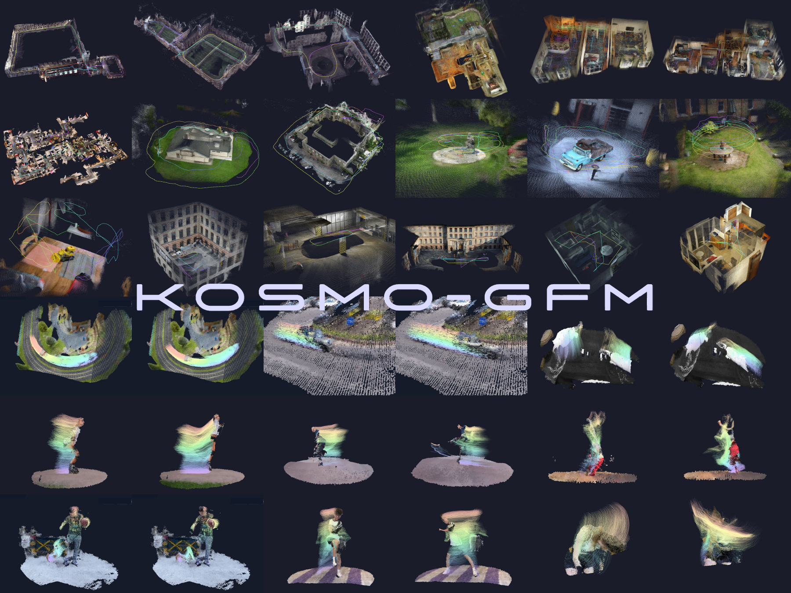

<div align="center">
<h1>Kosmo-GFM: A Production-Ready Geometry Foundation Model</h1>

<a href="#citation" title="arXiv link coming soon; see citation"></a>
<a href="https://kosmoresearch.github.io/Kosmo-GFM/" title="Project page"></a>
<a href="https://huggingface.co/KosmoResearch/Kosmo-GFM" title="Models on Hugging Face"></a>
<a href="#license" title="Apache 2.0 for original code; third-party terms also apply"></a>
<br>
<br>

<strong>Kosmo Research</strong>
<br>
<br>


</div>

## Overview

Kosmo-GFM predicts camera parameters, depth, cross-view correspondences, and
dynamic 3D points from images and videos. A shared multi-view encoder supports
task-specific geometry, motion, and matching decoders, with optional camera
conditioning for reconstruction from known poses.

This repository provides standalone inference for **GFM**, **Camera Condition GFM**,
**GFM 4D**, and **MVLoMA**. The full PoseEngine and Gaussian Splatting pipelines
described in the technical report are not included.

## Quick Start

Run the commands below from the repository root. See [Model Cards](#model-cards)
for model capabilities and checkpoint paths.

### Installation

Requires Python 3.10+ and a CUDA GPU. Install a compatible PyTorch / torchvision
build, then:

```bash
pip install -e .
# Optional PLY/GLB export
pip install -r requirements-optional.txt
```

### Inference

Run from the repository root with your own images or video frames.

#### GFM

```bash
python tools/infer_3d.py \
  --checkpoint weights/gfm_3d.pth --input /path/to/images \
  --output outputs/gfm --save-npz --no-ply --no-glb
```

Exports depth, confidence, cameras and point clouds to `predictions.npz`.
The default backbone is `vitg`; use `--model-size` to match your checkpoint.

#### Camera Condition GFM

The provided checkpoint is the **Camera-pose scale** version.

```bash
python tools/infer_3d_camera_cond.py \
  --checkpoint weights/gfm_3d_camera_cond.pth --input /path/to/images \
  --camera-npz /path/to/cameras.npz --output outputs/gfm_camera \
  --save-npz --no-ply --no-glb
```

The camera NPZ requires `extrinsics` (`[N,4,4]` or `[N,3,4]`, OpenCV
world-to-camera) and `intrinsics` (`[N,3,3]`, at original image resolution).
Cameras follow filename-sorted image order unless `image_names` is supplied.
Use `--camera-convention c2w` for camera-to-world matrices.

#### GFM 4D

```bash
python tools/infer_4d.py \
  --checkpoint weights/gfm_4d.pth --input /path/to/frames \
  --output outputs/gfm_4d --save-npz --no-ply --no-glb
```

Exports geometry, cameras and motion to `predictions.npz` at relative scene scale.
Use `--chunk-size` to control query decoding memory.

#### GFM with MVLoMA

```bash
python tools/infer_3d_with_mvloma.py \
  --checkpoint weights/gfm_3d.pth --mvloma-checkpoint weights/mvloma.pth \
  --input /path/to/images --output outputs/gfm_with_mvloma --no-ply --no-glb
```

Exports geometry to `predictions.npz` and image matches to `matches.npz`.
Requires at least two images. Use `--all-pairs` to export every image pair.

For PLY/GLB output, install the optional dependencies and omit
`--no-ply --no-glb`. Each script provides additional options through `--help`.

## Model Cards

All geometry models use a ViT-g backbone. Parameter counts are rounded for the
provided checkpoints. ✅ indicates a supported capability; — indicates it is
not part of that inference configuration.

| Model | Params | Depth | Camera Est. | Camera Cond. | 4D Motion | Matching |
| --- | --- | --- | --- | --- | --- | --- |
| [GFM](#gfm) | 1.66B | ✅ | ✅ | — | — | — |
| [Camera Condition GFM](#camera-condition-gfm) | 1.77B | ✅ | ✅ | ✅ | — | — |
| [GFM 4D](#gfm-4d) | 1.65B | ✅ | ✅ | — | ✅ | — |
| [GFM + MVLoMA](#gfm-with-mvloma) | 1.73B | ✅ | ✅ | — | — | ✅ |

- **Camera Condition GFM** is the **Camera-pose scale** version and takes
  camera extrinsics and intrinsics as input.
- **GFM + MVLoMA** shares the GFM encoder and adds a 75.9M-parameter matching
  head. It requires both the GFM and MVLoMA checkpoints.
- **GFM 4D** predicts geometry and cross-frame motion for Dynamic Points and
  Scene Flow evaluation.

Model repository: [KosmoResearch/Kosmo-GFM](https://huggingface.co/KosmoResearch/Kosmo-GFM).
Weights are not bundled. Place checkpoints at the following paths, or pass
your own paths to the inference scripts:

- GFM: `weights/gfm_3d.pth`
- Camera Condition GFM: `weights/gfm_3d_camera_cond.pth`
- GFM 4D: `weights/gfm_4d.pth`
- MVLoMA matching head: `weights/mvloma.pth`

## Benchmarks

### SpatialBench

GFM results on SpatialBench.
Higher is better for ↑; lower is better for ↓. Accuracy and AUC values are
reported on a 0–1 scale.

**Depth**

| Setting | AbsRel↓ | SqRel↓ | RMSE↓ | δ1.03↑ | δ1.05↑ | δ1.10↑ |
| --- | --- | --- | --- | --- | --- | --- |
| Sparse | 0.0630 | 0.1093 | 0.6207 | 0.6696 | 0.7810 | 0.8816 |
| Medium | 0.0594 | 0.0884 | 0.5822 | 0.6895 | 0.8077 | 0.9025 |

**Camera**

| Setting | RAcc3↑ | RAcc5↑ | TAcc3↑ | TAcc5↑ | AUC@5↑ | AUC@15↑ | AUC@30↑ |
| --- | --- | --- | --- | --- | --- | --- | --- |
| Sparse | 0.8358 | 0.9055 | 0.6457 | 0.7394 | 0.5726 | 0.7412 | 0.8226 |
| Medium | 0.8310 | 0.8938 | 0.6468 | 0.7322 | 0.5820 | 0.7450 | 0.8281 |

See [SpatialBench](bench/SpatialBench/README.md) for evaluation usage.

### GFM4DBench

GFM results on GFM4DBench.

| Dataset | Point APD (%)↑ | Point EPE (m)↓ | Flow Accuracy (%)↑ | Flow EPE (m)↓ |
| --- | --- | --- | --- | --- |
| Panoptic Studio | 83.41 | 0.1411 | 50.15 | 0.1257 |
| PointOdyssey | 85.73 | 0.1474 | 83.02 | 0.0521 |
| Dynamic Replica | 80.76 | 0.2017 | 91.31 | 0.0279 |
| Aria Digital Twin | 89.78 | 0.1102 | 96.34 | 0.0134 |
| SynthVerse | 42.49 | 1.1105 | 34.56 | 0.7213 |
| Mean | 76.43 | 0.3422 | 71.08 | 0.1881 |

Mean is the arithmetic average across all five datasets.

See [GFM4DBench](bench/GFM4DBench/README.md) for Dynamic Points and Scene Flow
evaluation on TapVid3D / WorldTrack and SynthVerse.

## Acknowledgements

Thanks to [VGGT](https://github.com/facebookresearch/vggt),
[DINOv2](https://github.com/facebookresearch/dinov2),
[Depth Anything 3](https://github.com/ByteDance-Seed/Depth-Anything-3),
[DPT](https://github.com/isl-org/DPT), [DeDoDe](https://github.com/Parskatt/DeDoDe),
[DaD](https://github.com/Parskatt/DaD), [LightGlue](https://github.com/cvg/LightGlue),
[SpatialBench](https://github.com/Ropedia/SpatialBench), and
[Open-d4rt](https://github.com/Lijiaxin0111/Open-d4rt).

## Citation

```bibtex
@techreport{kosmo2026gfm,
  title={{Kosmo-GFM}: A Production-Ready Geometry Foundation Model},
  author={{Kosmo Research}},
  institution={Kosmo Research},
  year={2026}
}
```

## License

Original code is licensed under [Apache-2.0](LICENSE). Third-party terms,
including the [VGGT use restrictions](licenses/VGGT-LICENSE.txt), also apply;
see [NOTICE](NOTICE) and [provenance notes](licenses/README.md).
Weights and datasets require separate licenses.
